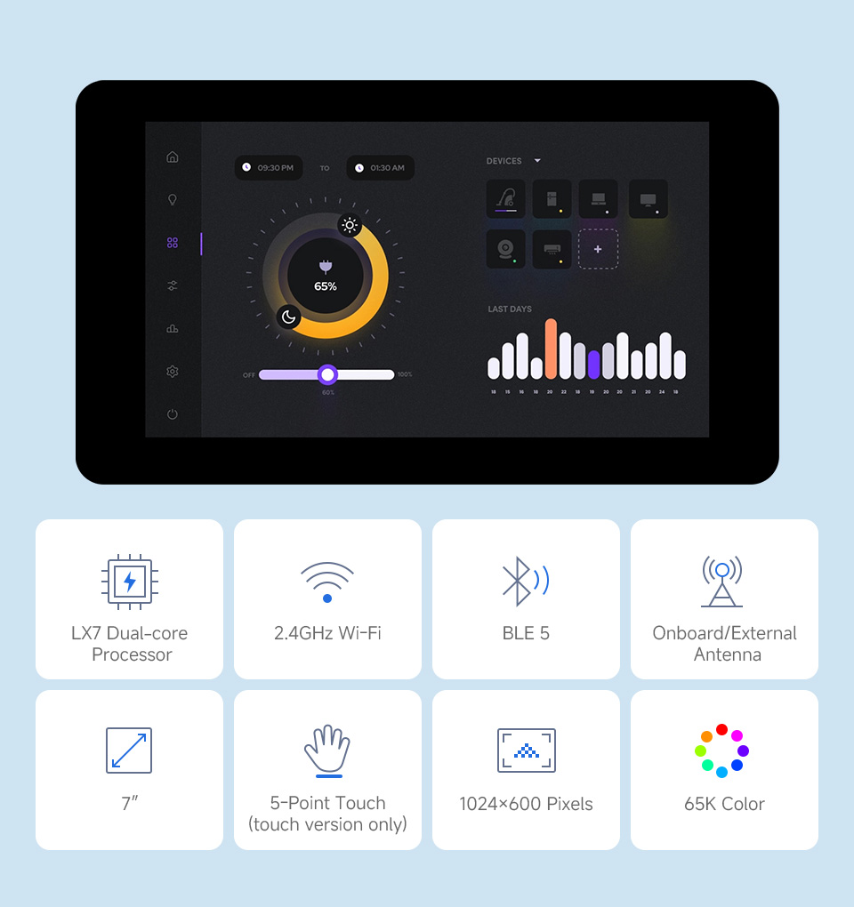
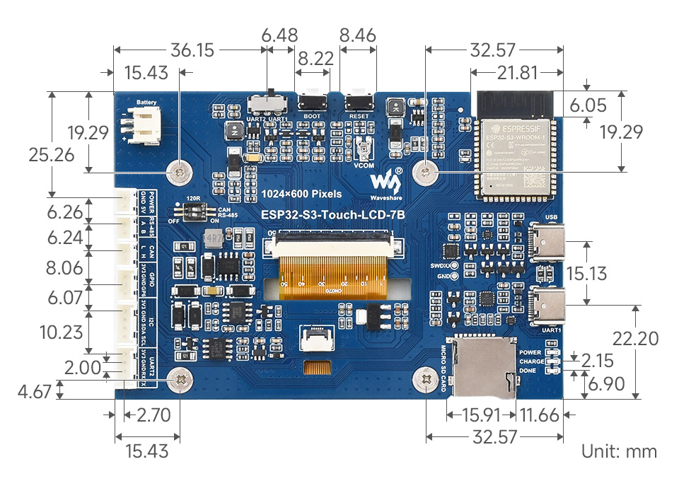
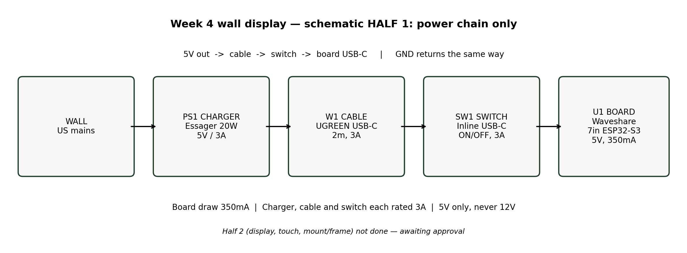
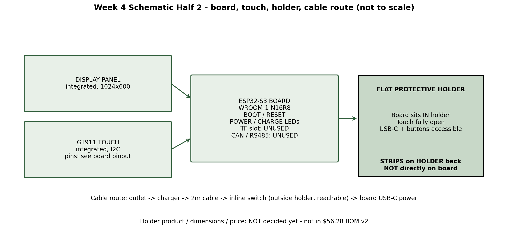

# Wall Display UI — DRAFT README (Sripad: rewrite in your own words before treating this as final)

> This README is a draft assembled from the project's working notes. It is
> NOT final, and it is NOT written in Sripad's own words yet. He must rewrite
> it before this repo is presented as finished.

## What

A single-sided wall display built on a Waveshare ESP32-S3 7-inch board
(Type B, Touch Function, 1024x600). It shows apps on a wall — clock,
weather, calendar, timer, tasks, calculator, notes, search, music
(display only), photos, maps, mail, settings — plus a recipe mode,
a photo clock, manual profiles, and a hand-signed Guestbook called
Core Memories. The home screen scrolls: Clock -> Widgets -> Apps.
Split view is deleted. Home controls (thermostat, door, fan, intercom)
were deleted at Sripad's direction and are not in this UI.

## Photos

Real product and schematic photos (not mockups, not wallpaper):

## Why

A wall display you actually walk up to and touch. The Guestbook is the
showpiece: a visitor signs with their hand, gets a celebration, adds
their name and who came with them, and the signature is saved on the
board with the date and time. Later, anyone can tap an entry and watch
that signature replay. That is the reason people come to the house and
leave a mark — not a form, a moment.

## How

- Board: Waveshare ESP32-S3 7-inch Display Development Board Type B,
  Touch Function, SKU 31726, 1024x600 IPS, GT911 5-point touch,
  ESP32-S3-WROOM-1-N16R8, 16 MB Flash / 8 MB PSRAM, outline
  192.96 x 110.76 mm, 5V / 350 mA. No camera connector on this board —
  camera was dropped, no extra camera board.
- Power, wall only: wall -> Essager 20W GaN charger (5V/3A) -> UGREEN
  2m USB-C cable (3A) -> inline USB-C switch cable (3A) -> board USB-C.
  No power bank, no hanging mount. The board sits in a flat protective
  holder; adhesive strips go on the holder, never directly on the board.
  Holder product/dimensions/price are still undecided and are NOT in
  the BOM total below.
- Firmware: `firmware/wall-display.ino` (original) and
  `firmware/wall-display-square.ino` (square-panel redesign, current).
  ESP32 core 3.3.12, LovyanGFX 1.2.36, LVGL 9.2.3, FlashSize=16M,
  PartitionScheme=app3M_fat9M_16MB, PSRAM=opi. Compile-verified only —
  NOT hardware-tested on the real board yet. Hero numerals are max
  48pt in firmware (LVGL font limit); mockups show larger numerals as
  a target only.
- Data, live only, never invented: Open-Meteo weather (no key, default
  Alpharetta 34.08/-84.29), Stooq daily CSV last close for stocks,
  ICS calendar (URL over Serial), OpenStreetMap tile fetch, Gmail IMAP
  (credentials over Serial only). Wi-Fi, ICS URL, mail credentials and
  any API keys are NEVER hardcoded — they go on-device over Serial.
  No fake time: NTP once Wi-Fi is set, otherwise uptime.
- UI directions: Apple HomeView-inspired layout, coded by us — our own
  code, generic glyphs, Inter in mockups / Montserrat on-device. NO
  Apple logos, NO Apple's SF font, NO pixel-exact Apple assets, NO
  copied album art or personal event/track text. Midnight Glass v2
  (dark, #0B0E14 / #1A1F2B / #0A84FF) for everything except Guestbook;
  Guestbook keeps its separate liquid-chrome full-bleed look.
  Home screen v3 is light Apple-style: pale blue clock hero, GOOD
  MORNING dashboard with weather, analog clock, calendar tile, and
  app icons at the bottom (see design-previews/).

## BOM (Week 4 v2, before shipping/tax — see hardware/BOM-v2.md)

| Item | Vendor | Sale | List |
|---|---|---|---|
| ESP32-S3 7-inch Board Type B, Touch, 1024x600 | Waveshare | $38.99 | $38.99 |
| Essager 20W GaN USB-C charger, US White | AliExpress | $4.55 | $9.48 |
| UGREEN USB-C cable 2m, PD60W 3A | AliExpress | $5.37 | $9.37 |
| Inline USB-C switch cable 30cm, Black | AliExpress | $1.09 | $6.47 |
| Hyper Tough Large Removable Adhesive Strips | Walmart | $6.28 | $6.28 |
| **Total before shipping/tax** | | **$56.28** | **$70.59** |

Headroom to the $100 Tier 3 cap: $43.72 at sale prices. Shipping/tax,
holder, wall/outlet distance, and checkout totals are still unverified.
Nothing is ordered. No purchase without Sripad's tap on an exact total.

## Guestbook — Core Memories (8 steps, 7 animations)

1. Guestbook home — Leave your mark, recent entries, View All
2. Handwritten signature canvas — draw with hand, Undo / Clear / Done
3. Signature captured celebration — ink-to-chrome, stamp press, liquid ripple
4. Guest details — name + who came with you
5. Saved confirmation — card develops, signature + name + who + date/time, OK
6. Signature replay — light trace along the exact saved stroke
7. Memories gallery — All / Favorites / With friends / This week
8. Individual memory — replay + favorite star (chrome seal), saved on-device

Plus: the pad glows silver while you sign. No generic confetti, no emoji
rain. Entries live on-device in Preferences only, never sent anywhere.
Caps: 20 entries (oldest dropped), 8 strokes, 150 points per signature.
Firmware list starts empty; only visitor-entered names ever appear.

## What is NOT in this repo

- Third-party base repos, pushed whole: they are reference only, credited
  in docs/notes/ (esp32-spotify-controller, ESP32-lvgl-widgets,
  jadivclock, windows-10-mobile-lvgl, esphome-lvgl-clock, infohub,
  esp32-file-manager — all MIT, LICENSE kept in local copies only).
- AI-generated graphics as final repo graphics: all mockup PNGs live
  ONLY in design-previews/ (see that folder's README) and are NOT main
  README images. Main images must be real product/schematic photos,
  uploaded manually — PNGs are not pushed via the text-only GitHub route.
- No credentials, no API keys, no app passwords anywhere in this repo.
- No home controls, no split view, no camera, no FaceTime, no real
  browser, no voice assistant, no music playback (display only),
  no live camera feed — none of those are claimed as working.

## Build / status (honest)

- Firmware compiles clean (square copy, latest verified: 1,521,847 bytes
  / 48%, globals 255,056 / 77% — see firmware/README.md for the full
  history). It has NOT been tested on the real board: display, touch,
  backlight, swipe, and animation timing are unverified on hardware.
- Design weeks rule, stated honestly: most parts designed by Sripad;
  AI coding help is used, and this draft README itself is AI-assembled
  and must be rewritten in his own words.
